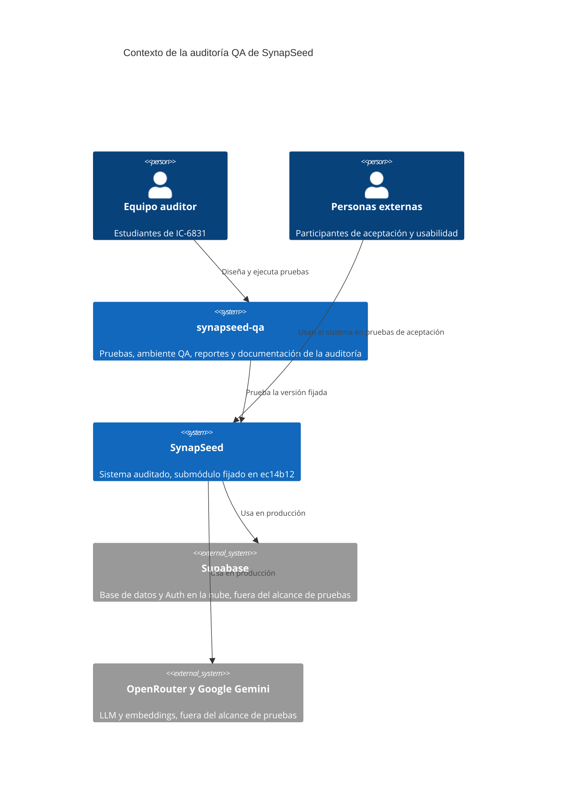

# Documentación técnica - SynapSeed QA

## Arquitectura general

El repo separa el sistema auditado del trabajo del auditor. SynapSeed entra como submódulo de git fijado en una versión concreta; todo lo demás es producción del equipo de QA.

| Carpeta | Responsabilidad |
|---------|-----------------|
| `synapseed/` | Submódulo con el sistema auditado, fijado en el commit `ec14b12`. No se modifica: los defectos se reportan, no se corrigen |
| `env/` | Ambiente QA local: configuración para levantar SynapSeed sin servicios de terceros y datos sintéticos |
| `tests/` (raíz) | Configuración compartida: `conftest.py` (path al backend, marcas por tipo, fixtures comunes), `playwright.config.js` y `package.json` de Playwright |
| `tests/auth-seguridad/` | Área de la Persona A: registro, inicio de sesión, verificaciones de seguridad y escenarios de carga |
| `tests/zonas-catalogos/` | Área de la Persona B: zonas de cultivo y catálogos del asistente |
| `tests/recomendacion/` | Área de la Persona C: pipeline de recomendación, proveedores e historial |
| `tests/<área>/<tipo>/` | Dentro de cada área: `unit` (dobles de prueba), `integration` (efecto de lado en la base o la cola), `e2e` (Playwright), `api` (colección de Postman); en auth-seguridad además `security` y `performance` (k6) |
| `docs/` | Plan de calidad, GQM y fichas de métricas, estáticas, casos de prueba por persona, UAT, usabilidad, matriz de trazabilidad, defectos e informe final |
| `reports/` | Evidencia de cada corrida: `coverage`, `ruff`, `sonar`, `k6`, `zap`, `e2e` |

### Cómo se ejecutan las pruebas

- **pytest** corre desde la raíz con el Python del submódulo. `pytest.ini` usa `--import-mode=importlib`, que permite archivos con el mismo nombre en áreas distintas. `tests/conftest.py` agrega `synapseed/src/backend` al path para importar `app.*` y marca cada prueba según la subcarpeta de tipo, así `-m unit` junta las unitarias de las tres áreas.
- **Playwright** usa una sola configuración en `tests/` que busca `**/e2e/**/*.spec.js`. Guarda traza y captura de cada fallo y un reporte HTML por corrida en `reports/e2e/`.
- **k6, ZAP y SonarQube** se corren con sus imágenes oficiales de Docker, sin instalar nada en las máquinas. `sonar-project.properties` limita el análisis al código de SynapSeed.

## Decision Log

### [2026-11-26] Herramientas externas por Docker y variables documentadas en el README

**Contexto:** El enunciado sugiere k6, OWASP ZAP y SonarQube, y pide un archivo de ejemplo de variables de entorno sin valores reales. Instalar esas herramientas en tres máquinas distintas consume tiempo y produce diferencias entre integrantes; además, la convención del equipo es no crear archivos `.env.example`.
**Decisión:** k6, ZAP y SonarQube se ejecutan con sus imágenes oficiales de Docker, que ya está instalado para levantar SynapSeed. Las pruebas de API usan Postman. Las variables de entorno se documentan en la tabla del README, sin crear un archivo de ejemplo.
**Consecuencias:** Todas las personas corren las mismas versiones con el mismo comando. El informe debe explicar que la tabla del README cumple la función del archivo de ejemplo.

### [2026-11-26] Pruebas separadas por área funcional con un dueño por área

**Contexto:** Tres personas escriben pruebas al mismo tiempo durante cuatro días. Con carpetas por tipo (`tests/unit`, `tests/e2e`) todas editarían las mismas carpetas y archivos, con más conflictos de merge, y el aporte individual sería más difícil de ver.
**Decisión:** `tests/` se divide en `auth-seguridad`, `zonas-catalogos` y `recomendacion`, cada una con subcarpetas por tipo. La configuración compartida queda en la raíz de `tests/`. Las marcas de pytest se asignan automáticamente por subcarpeta, y las colecciones de Postman son una por área.
**Consecuencias:** Cada persona trabaja y hace commit en su carpeta, y el historial muestra el aporte de cada quien. Se puede correr todo, un área o un tipo. Los archivos compartidos y los documentos consolidados (defectos, matriz, informe) siguen requiriendo coordinación.

### [2026-11-24] DATABASE_URL apunta al Session pooler de Supabase

**Contexto:** Con el Transaction pooler (puerto 6543), backend y worker fallan con `DuplicatePreparedStatementError` y el pipeline de recomendación no termina. `app/db/session.py` no define nombres únicos para las sentencias preparadas, y PgBouncer en modo transacción las reutiliza entre conexiones.
**Decisión:** En el `.env` local, `DATABASE_URL` usa el Session pooler (mismo host, puerto 5432). `DATABASE_URL_SYNC` sigue en el puerto 6543. El código de SynapSeed no se modifica.
**Consecuencias:** El flujo de recomendación se completa y se puede probar. El defecto sigue presente en la configuración original y se reporta (hallazgo 11). El Session pooler mantiene una conexión por cliente, lo que limita la concurrencia en las pruebas de carga; hay que tenerlo en cuenta al interpretar sus resultados.

### [2026-11-24] Override de compose para fijar kombu en backend y worker

**Contexto:** Al levantar SynapSeed con su propio `docker-compose.yml`, el worker de Celery se reinicia en bucle con `kombu.exceptions.VersionMismatch: Redis transport requires redis-py versions 6.1.0 or later. You have 5.2.1`. El backend fija `celery==5.4.0` y `redis==5.2.1`, pero no fija `kombu`, y pip instala kombu 5.7.0. Sin worker no se procesa ninguna recomendación.
**Decisión:** Agregar `env/docker-compose.kombu-fix.yml`, un override que instala `kombu>=5.4,<5.5` al iniciar el contenedor del worker y luego arranca Celery con el mismo comando del `Dockerfile.worker`. Se usa junto al compose original, sin modificar el submódulo.
**Consecuencias:** El worker arranca y se conecta a Redis, así que el flujo de recomendaciones se puede probar. El defecto sigue existiendo en SynapSeed y se reporta como tal. Cada arranque del worker reinstala kombu, lo que agrega unos segundos.

### [2026-11-24] El submódulo ignora archivos sin seguimiento

**Contexto:** Al instalar dependencias dentro del submódulo (por ejemplo `npm install` en el frontend) se generan archivos que SynapSeed no versiona, como `package-lock.json`. Git marcaba entonces el submódulo como modificado en cada `git status`.
**Decisión:** Configurar `ignore = untracked` para el submódulo en `.gitmodules`.
**Consecuencias:** `git status` solo muestra cambios reales en el código auditado. Un archivo nuevo creado por error dentro de `synapseed/` no se verá en el estado del repo principal; hay que revisarlo con `git -C synapseed status`.

### [2026-11-24] Repo aparte con SynapSeed como submódulo fijado

**Contexto:** La auditoría necesita una versión del sistema que no cambie durante el proyecto. Además, las pruebas y configuraciones del equipo no deben mezclarse con el código auditado ni alterar sus métricas de mantenibilidad, y el historial de commits del equipo sirve como evidencia del aporte individual.
**Decisión:** Crear `synapseed-qa` como repo independiente e incluir SynapSeed como submódulo fijado en el commit `ec14b12`.
**Consecuencias:** El informe se refiere siempre a la misma versión, y SonarQube, Ruff y la cobertura miden solo el código de SynapSeed. Como contra, las pruebas unitarias viven fuera del código que prueban: pytest y Vitest deben configurarse para apuntar al submódulo. Cambiar la versión auditada exige actualizar el submódulo a propósito y registrarlo aquí.
