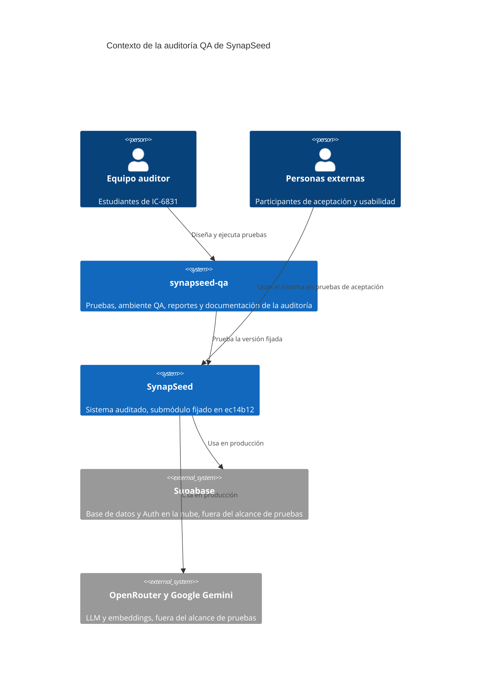
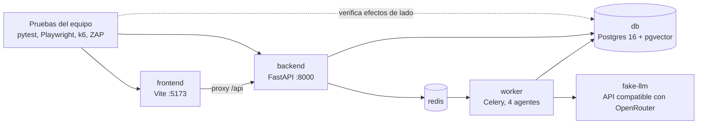

# Documentación técnica - SynapSeed QA

## Arquitectura general

El repo separa el sistema auditado del trabajo del auditor. SynapSeed entra como submódulo de git fijado en una versión concreta; todo lo demás es producción del equipo de QA.

| Carpeta | Responsabilidad |
|---------|-----------------|
| `synapseed/` | Submódulo con el sistema auditado, fijado en el commit `ec14b12`. No se modifica: los defectos se reportan, no se corrigen |
| `env/` | Ambientes de ejecución: `docker-compose.kombu-fix.yml` (configuración original con Supabase) y el ambiente QA local `docker-compose.qa.yml` con su LLM falso (`fake_llm/`), el contorno de enums (`align_enums.py`) y el seed sintético (`seed_synthetic.py`) |
| `tests/` (raíz) | Configuración compartida: `conftest.py` (path al backend, marcas por tipo, fixtures comunes), `playwright.config.js` y `package.json` de Playwright |
| `tests/auth-seguridad/` | Área de la Persona A: registro, inicio de sesión, verificaciones de seguridad y escenarios de carga |
| `tests/zonas-catalogos/` | Área de la Persona B: zonas de cultivo y catálogos del asistente |
| `tests/recomendacion/` | Área de la Persona C: pipeline de recomendación, proveedores e historial |
| `tests/<área>/<tipo>/` | Dentro de cada área: `unit` (dobles de prueba), `integration` (efecto de lado en la base o la cola), `e2e` (Playwright), `api` (colección de Postman); en auth-seguridad además `security` y `performance` (k6) |
| `docs/` | Plan de calidad, GQM y fichas de métricas, estáticas, casos de prueba por persona, UAT, usabilidad, matriz de trazabilidad, defectos e informe final |
| `reports/` | Evidencia de cada corrida: `pytest`, `coverage`, `ruff`, `sonar`, `k6`, `zap`, `e2e`, y `manual` para verificaciones hechas a mano. Es lo que respalda el campo Evidencia de cada caso de prueba en el informe final |

### Cómo se ejecutan las pruebas

- **pytest** corre desde la raíz con el Python del submódulo. `pytest.ini` usa `--import-mode=importlib`, que permite archivos con el mismo nombre en áreas distintas. `tests/conftest.py` agrega `synapseed/src/backend` al path para importar `app.*` y marca cada prueba según la subcarpeta de tipo, así `-m unit` junta las unitarias de las tres áreas.
- **Fixtures por área**: cada área puede tener su propio `conftest.py` con sus fixtures. El de `auth-seguridad` trae un cliente HTTP con `urllib` (`api`), que salta las pruebas si el ambiente QA no responde, usuarios sintéticos con cédulas que empiezan en 8 para no chocar con el seed, y una conexión de lectura a la base local (`qa_db`, configurable con `QA_DB_URL`).
- **Defectos conocidos**: una prueba que confirma un defecto lleva `@pytest.mark.xfail(strict=True, reason="DEF-A01, hallazgo N: ...")`. Aparece como `XFAIL`, la suite sigue en verde y, si el defecto se corrige, pasa a `XPASS` y la suite falla para que se quite la marca.
- **URLs por defecto**: se usa `127.0.0.1` y no `localhost`, porque en Windows `localhost` intenta primero IPv6 y agrega unos 2 s a cada petición (11 pruebas de integración pasaron de 49 s a 5 s).
- **Playwright** usa una sola configuración en `tests/` que busca `**/e2e/**/*.spec.js`. Guarda traza y captura de cada fallo y un reporte HTML por corrida en `reports/e2e/`.
- **k6, ZAP y SonarQube** se corren con sus imágenes oficiales de Docker, sin instalar nada en las máquinas. `tests/auth-seguridad/performance/run_k6.sh` une el contenedor de k6 (`grafana/k6:1.0.0`) a la red `synapseed-qa_default`, así llega al backend por nombre, y guarda la salida y el resumen JSON de cada corrida en `reports/k6/`. Si un umbral no se cumple, k6 sale con código 99: el script lo informa y conserva los reportes. Los umbrales se declaran en `docs/plan-calidad.md` antes de correr. `.gitattributes` fuerza LF en los `.sh`, porque con `core.autocrlf=true` llegarían con CRLF y bash fallaría en WSL. `sonar-project.properties` limita el análisis al código de SynapSeed.

## Ambiente QA local

El enunciado solo permite pruebas de seguridad y de carga sobre un ambiente levantado por el equipo. `env/docker-compose.qa.yml` levanta SynapSeed completo sin servicios de terceros y sin modificar el submódulo.

Flujo de arranque del backend:

1. Instala `kombu` compatible (mismo contorno que la configuración original).
2. Genera un `JWT_SECRET` aleatorio.
3. Corre `alembic upgrade head`.
4. Corre `align_enums.py`.
5. Levanta uvicorn.

El seed sintético se corre a mano una vez por base nueva.

Cómo responde el LLM falso:

- Distingue el agente por el nombre del schema que el cliente inyecta en el prompt de sistema (`ContextAnalysisOutput`, `_LegalLLMReview`, `_SynthesisLLMResponse`).
- El analizador devuelve el cultivo y el problema del formulario.
- El validador legal aprueba todos los candidatos que sobrevivieron a las reglas duras.
- El sintetizador justifica los productos que recibe.

Así se prueba todo el código del pipeline (búsqueda, reglas regulatorias, persistencia, estados) sin depender del contenido variable de un LLM real. La calidad del texto y la pertinencia agronómica de las recomendaciones no se evalúan en este ambiente: eso queda para la configuración original y la validación con personas.

## Decision Log

### [2026-11-27] Defectos con ID por persona y escalas comunes de severidad y prioridad

**Contexto:** Tres personas registran defectos en el mismo `docs/defectos.md` durante los mismos días. Con una numeración única (`DEF-01`, `DEF-02`), dos personas tomarían el mismo número y chocarían al hacer merge. Además, sin una escala común, "Alta" significaría cosas distintas para cada quien y el informe no podría comparar defectos.
**Decisión:** Cada persona usa su prefijo (`DEF-A01`, `DEF-B01`, `DEF-C01`) y escribe en su propia sección. Las escalas de severidad (Crítica, Alta, Media, Baja) y de prioridad (Alta, Media, Baja) se definen una sola vez al inicio de `defectos.md`. Cada defecto apunta a una evidencia guardada en `reports/`; lo verificado a mano se guarda como texto en `reports/manual/`.
**Consecuencias:** No hay conflictos de numeración y cada aporte queda identificable. La Persona C consolida el resumen sin renumerar. La prioridad es una propuesta del equipo auditor, no una decisión del equipo de SynapSeed.

### [2026-11-26] Los defectos conocidos se marcan con xfail estricto

**Contexto:** Algunas pruebas automatizadas existen para confirmar un defecto, como `test_cp_rf01_07_esquemas_de_registro_consistentes` (hallazgo 17). Si fallan en rojo, la suite queda rota para todo el equipo y se pierde la señal de los fallos nuevos. Si se omiten, el defecto no queda trazado a ninguna prueba.
**Decisión:** Esas pruebas llevan `@pytest.mark.xfail(strict=True, reason="DEF-A01, hallazgo N: ...")`. Aparecen como `XFAIL` y la suite sigue en verde; si alguien corrige el defecto, la prueba pasa a `XPASS` y la suite falla, para que se quite la marca. En el caso de prueba, el estado queda como "Falla" con el número de hallazgo.
**Consecuencias:** El reporte de pytest distingue los defectos conocidos de los fallos nuevos. Cada `reason` empieza con el ID del defecto en `defectos.md` y cita el hallazgo de origen.

### [2026-11-26] Ambiente QA local con Postgres propio, LLM falso y seed sintético

**Contexto:** Las pruebas de seguridad y de carga no pueden correr contra Supabase, OpenRouter ni Gemini. SynapSeed no trae un ambiente local funcional:
- `docker-compose.yml` no define base de datos;
- el worker usa siempre `OpenRouterLLMClient`;
- el seed depende de CSV que no están en el repo (hallazgo 25);
- una base creada con las migraciones rechaza los valores de enum que escribe el ORM (hallazgo 26).

**Decisión:** Un compose propio en `env/docker-compose.qa.yml` con estas piezas:
- **Postgres pgvector local.**
- **LLM falso** hecho con la librería estándar de Python. Se apunta `OPENROUTER_BASE_URL` a él, así el cliente real de SynapSeed se ejecuta sin cambios.
- **Autenticación local**, dejando vacías las variables de Supabase.
- **Script que alinea los enums** con los de Supabase después de las migraciones.
- **Seed sintético** que reutiliza las funciones `seed_regulations` y `link_products_distributors` del sistema.

Los valores del compose no son secretos reales, porque la base es desechable y solo escucha en 127.0.0.1. El `JWT_SECRET` se genera al azar en cada arranque.

**Consecuencias:**
- El ambiente se levanta con dos comandos, sin `.env` y sin costo.
- Las recomendaciones tardan unos 2 s, así que las pruebas de carga miden el sistema y no al LLM. Se puede simular latencia con `FAKE_LLM_DELAY_MS`.
- La pertinencia de las recomendaciones no se puede evaluar aquí.
- El modo de autenticación local habilita `POST /auth/reset-password` (hallazgo 27). Es parte de lo que se audita, no un efecto secundario a evitar.
- Reiniciar el backend invalida los tokens emitidos.
- Con Docker en WSL hay que mantener una terminal de WSL abierta. Por eso los servicios usan `restart: unless-stopped`.

### [2026-11-26] Herramientas externas por Docker y variables documentadas en el README

**Contexto:** El enunciado sugiere k6, OWASP ZAP y SonarQube, y pide un archivo de ejemplo de variables de entorno sin valores reales. Instalar esas herramientas en tres máquinas distintas consume tiempo y produce diferencias entre integrantes; además, la convención del equipo es no crear archivos `.env.example`.
**Decisión:** k6, ZAP y SonarQube se ejecutan con sus imágenes oficiales de Docker, que ya está instalado para levantar SynapSeed. Las pruebas de API usan Postman. Las variables de entorno se documentan en la tabla del README, sin crear un archivo de ejemplo.
**Consecuencias:** Todas las personas corren las mismas versiones con el mismo comando. El informe debe explicar que la tabla del README cumple la función del archivo de ejemplo.

### [2026-11-26] Pruebas separadas por área funcional con un dueño por área

**Contexto:** Tres personas escriben pruebas al mismo tiempo durante cuatro días. Con carpetas por tipo (`tests/unit`, `tests/e2e`) todas editarían las mismas carpetas y archivos, con más conflictos de merge, y el aporte individual sería más difícil de ver.
**Decisión:** `tests/` se divide en `auth-seguridad`, `zonas-catalogos` y `recomendacion`, cada una con subcarpetas por tipo. La configuración compartida queda en la raíz de `tests/`. Las marcas de pytest se asignan automáticamente por subcarpeta, y las colecciones de Postman son una por área.
**Consecuencias:** Cada persona trabaja y hace commit en su carpeta, y el historial muestra el aporte de cada quien. Se puede correr todo, un área o un tipo. Los archivos compartidos y los documentos consolidados (defectos, matriz, informe) siguen requiriendo coordinación.

### [2026-11-24] DATABASE_URL apunta al Session pooler de Supabase

**Contexto:** Con el Transaction pooler (puerto 6543), backend y worker fallan con `DuplicatePreparedStatementError` y el pipeline de recomendación no termina. `app/db/session.py` no define nombres únicos para las sentencias preparadas, y PgBouncer en modo transacción las reutiliza entre conexiones.
**Decisión:** En el `.env` local, `DATABASE_URL` usa el Session pooler (mismo host, puerto 5432). `DATABASE_URL_SYNC` sigue en el puerto 6543. El código de SynapSeed no se modifica.
**Consecuencias:** El flujo de recomendación se completa y se puede probar. El defecto sigue presente en la configuración original y se reporta (hallazgo 11). El Session pooler mantiene una conexión por cliente, lo que limita la concurrencia en las pruebas de carga; hay que tenerlo en cuenta al interpretar sus resultados.

### [2026-11-24] Override de compose para fijar kombu en backend y worker

**Contexto:** Al levantar SynapSeed con su propio `docker-compose.yml`, el worker de Celery se reinicia en bucle con `kombu.exceptions.VersionMismatch: Redis transport requires redis-py versions 6.1.0 or later. You have 5.2.1`. El backend fija `celery==5.4.0` y `redis==5.2.1`, pero no fija `kombu`, y pip instala kombu 5.7.0. Sin worker no se procesa ninguna recomendación.
**Decisión:** Agregar `env/docker-compose.kombu-fix.yml`, un override que instala `kombu>=5.4,<5.5` al iniciar el contenedor del worker y luego arranca Celery con el mismo comando del `Dockerfile.worker`. Se usa junto al compose original, sin modificar el submódulo.
**Consecuencias:** El worker arranca y se conecta a Redis, así que el flujo de recomendaciones se puede probar. El defecto sigue existiendo en SynapSeed y se reporta como tal. Cada arranque del worker reinstala kombu, lo que agrega unos segundos.

### [2026-11-24] El submódulo ignora archivos sin seguimiento

**Contexto:** Al instalar dependencias dentro del submódulo (por ejemplo `npm install` en el frontend) se generan archivos que SynapSeed no versiona, como `package-lock.json`. Git marcaba entonces el submódulo como modificado en cada `git status`.
**Decisión:** Configurar `ignore = untracked` para el submódulo en `.gitmodules`.
**Consecuencias:** `git status` solo muestra cambios reales en el código auditado. Un archivo nuevo creado por error dentro de `synapseed/` no se verá en el estado del repo principal; hay que revisarlo con `git -C synapseed status`.

### [2026-11-24] Repo aparte con SynapSeed como submódulo fijado

**Contexto:** La auditoría necesita una versión del sistema que no cambie durante el proyecto. Además, las pruebas y configuraciones del equipo no deben mezclarse con el código auditado ni alterar sus métricas de mantenibilidad, y el historial de commits del equipo sirve como evidencia del aporte individual.
**Decisión:** Crear `synapseed-qa` como repo independiente e incluir SynapSeed como submódulo fijado en el commit `ec14b12`.
**Consecuencias:** El informe se refiere siempre a la misma versión, y SonarQube, Ruff y la cobertura miden solo el código de SynapSeed. Como contra, las pruebas unitarias viven fuera del código que prueban: pytest y Vitest deben configurarse para apuntar al submódulo. Cambiar la versión auditada exige actualizar el submódulo a propósito y registrarlo aquí.
